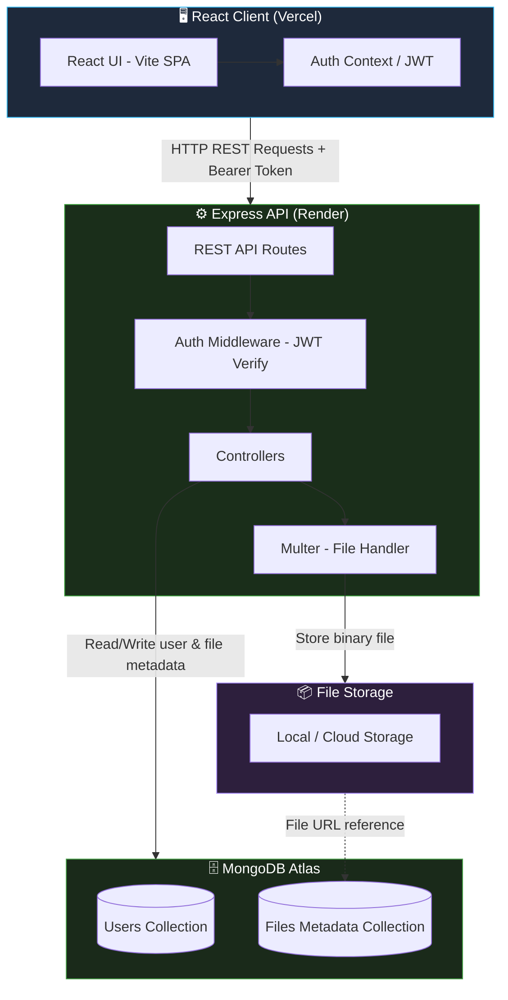
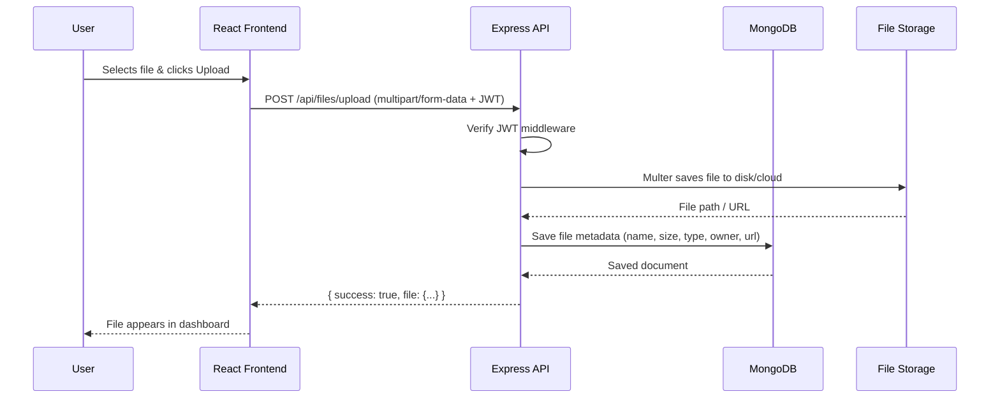

# 🗂️ Mini Drive

> A lightweight, full-stack cloud file storage app — upload, manage, and access your files from anywhere.

<p align="left">
  
  
  
  
  
  
</p>

🌐 **Live Demo:** [mini-drive-phi.vercel.app](https://mini-drive-phi.vercel.app)

---

## 📖 Overview

**Mini Drive** is a Google Drive-inspired file storage application built with the **MERN stack**. Users can sign up, upload files, organise them, and access them from any device. The frontend is a fast Vite/React SPA deployed on Vercel; the backend is a Node.js/Express REST API deployed on Render, with files and metadata persisted in MongoDB Atlas.

## ✨ Features

| Feature | Status |
|---|---|
| 🔐 User authentication (JWT) | ✅ |
| 📤 File upload & storage | ✅ |
| 📁 File listing & management | ✅ |
| 🔒 Secure per-user file access | ✅ |
| 🌐 Cloud deployment (Vercel + Render) | ✅ |
| 📂 Folder/directory support | 🛣️ Roadmap |
| 🔗 Shareable file links | 🛣️ Roadmap |
| 🔍 File search | 🛣️ Roadmap |

---

## 🛠️ Tech Stack

| Layer | Technology |
|---|---|
| Frontend | React (Vite) |
| Backend | Node.js, Express.js |
| Database | MongoDB Atlas |
| Authentication | JWT + Bcrypt |
| File Handling | Multer |
| Frontend Hosting | Vercel |
| Backend Hosting | Render |
| Dev tooling | Concurrently |

---

## 🏗️ System Architecture

Mini Drive follows a **3-tier client–server architecture** with a decoupled frontend and backend, both independently deployed to cloud platforms.



---

## 🔄 Data Flow

### 1. User Authentication

```mermaid
sequenceDiagram
    participant U as User (Browser)
    participant FE as React Frontend
    participant API as Express API
    participant DB as MongoDB Atlas

    U->>FE: Enters email + password
    FE->>API: POST /api/auth/login
    API->>DB: Find user by email
    DB-->>API: User document
    API->>API: Bcrypt verify password
    API-->>FE: { token: JWT }
    FE->>FE: Store JWT in localStorage
    FE-->>U: Redirect to dashboard
```



### 2. File Upload Flow



---

## 📂 Project Structure

```
mini-drive/
├── backend/
│   ├── src/
│   │   ├── config/          # DB connection, env config
│   │   ├── controllers/     # Auth & file logic
│   │   ├── middleware/      # JWT auth middleware
│   │   ├── models/          # Mongoose schemas (User, File)
│   │   ├── routes/          # API route definitions
│   │   └── index.js         # Express app entry point
│   └── package.json
│
├── frontend/
│   ├── src/
│   │   ├── components/      # Reusable UI components
│   │   ├── pages/           # Dashboard, Login, Signup
│   │   ├── context/         # Auth context / state
│   │   ├── api/             # Axios API calls
│   │   ├── App.jsx
│   │   └── main.jsx
│   ├── dist/                # Vercel build output
│   └── package.json
│
├── vercel.json              # Vercel frontend build config
├── package.json             # Root: concurrently dev script
└── .gitignore
```
> 💡 Adjust to match your actual file names if they differ.

---

## 🚀 Getting Started

### Prerequisites

- Node.js ≥ 18
- npm
- A [MongoDB Atlas](https://www.mongodb.com/cloud/atlas) cluster (free tier works)

### Installation

```bash
# Clone the repo
git clone https://github.com/Ravi11-Avi/mini-drive.git
cd mini-drive
```

### Backend Setup

```bash
cd backend
npm install
```

Create `backend/.env`:

```env
PORT=5000
MONGO_URI=mongodb+srv://<user>:<password>@cluster.mongodb.net/mini-drive
JWT_SECRET=your_super_secret_key
```

### Frontend Setup

```bash
cd frontend
npm install
```

Create `frontend/.env`:

```env
VITE_API_URL=http://localhost:5000/api
```

### Run Both Together (from root)

```bash
# In the root directory
npm install        # installs concurrently
npm run dev        # starts both frontend & backend simultaneously
```

| Service | URL |
|---|---|
| Frontend | http://localhost:5173 |
| Backend API | http://localhost:5000 |

---

## 🌐 Deployment

| Platform | Service | URL |
|---|---|---|
| Vercel | Frontend | [mini-drive-phi.vercel.app](https://mini-drive-phi.vercel.app) |
| Render | Backend | [mini-drive-ndlx.onrender.com](https://mini-drive-ndlx.onrender.com) |

### Deploy Frontend (Vercel)

Push to `main` — Vercel auto-builds from `frontend/package.json` → `frontend/dist` (configured in `vercel.json`).

### Deploy Backend (Render)

Set these environment variables in Render's dashboard:

```env
MONGO_URI=...
JWT_SECRET=...
PORT=5000
```

> ⚠️ Render free tier spins down after 15 minutes of inactivity. First request may be slow.

---

## 🧪 Testing

No automated test suite yet. Use this checklist before pushing changes:

- [ ] Register a new user
- [ ] Log in with valid credentials
- [ ] Receive JWT and access the dashboard
- [ ] Upload a file successfully
- [ ] View uploaded files in the dashboard
- [ ] Try accessing another user's file — should be blocked (403)
- [ ] Log out and confirm protected routes redirect to login

**Planned:** Unit tests with [Vitest](https://vitest.dev/), API integration tests with [Supertest](https://github.com/ladjs/supertest).

---

## 🛣️ Roadmap

- [ ] Folder / directory support
- [ ] Shareable file links (public/private)
- [ ] File search & filtering
- [ ] File preview (images, PDFs)
- [ ] AWS S3 or Cloudinary for scalable file storage
- [ ] Automated test suite

## 🤝 Contributing

1. Fork the repo
2. Create a feature branch (`git checkout -b feature/your-feature`)
3. Commit your changes (`git commit -m "feat: add your feature"`)
4. Push to the branch (`git push origin feature/your-feature`)
5. Open a Pull Request

## 📄 License

This project is licensed under the [MIT License](LICENSE).

## 👤 Author

**Aviansh (Ravi11-Avi)**
🌐 [Portfolio](https://ravi11-avi.github.io/Portfolio/) · 🐙 [GitHub](https://github.com/Ravi11-Avi)
